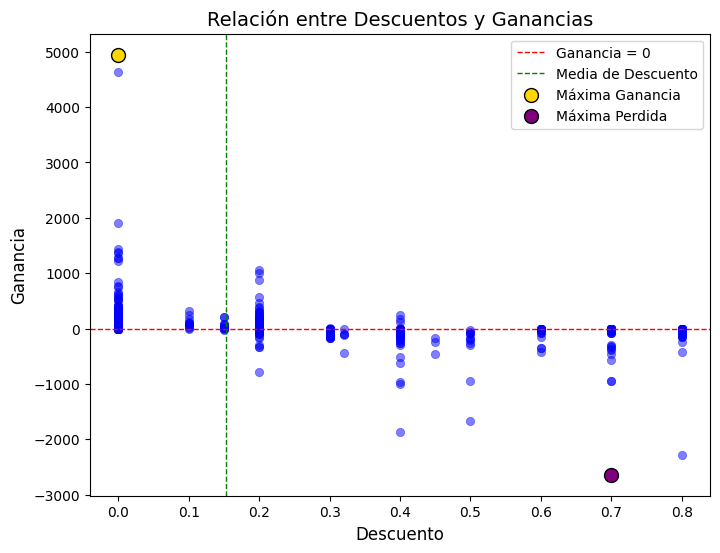

# Rentabilidad y descuentos en ventas minoristas

Caso de análisis exploratorio realizado a partir del trabajo final de Estadística Aplicada de un diplomado. El curso entregó un CSV de ventas y una consigna; desarrollé los ejercicios y añadí un análisis de márgenes, descuentos y recomendaciones. Esta versión presenta lo más útil para un puesto de analista de datos y permite verificar las cifras con el archivo incluido.



*Gráfico de la sección “ANÁLISIS EXTRA” del notebook académico: cada punto representa una venta; la línea horizontal marca ganancia cero.*

**Resultado principal:** cuatro subcategorías registraron pérdida neta. Los registros con descuentos mayores al 20% también sumaron pérdidas, una asociación descriptiva que no demuestra causalidad.

## Inicio rápido

Requiere Python 3.10 o posterior. Desde la raíz del repositorio:

```powershell
python -m pip install -r requirements.txt
python analysis.py
```

El script lee `data/RetailNuevo3.csv`, imprime los agregados y regenera `images/profit_by_subcategory.png`. También acepta otro archivo con `python analysis.py --data ruta/al/archivo.csv` si conserva las columnas necesarias.

## Estructura

```text
.
├── README.md                         # resumen para portafolio
├── analysis.py                       # cálculo y gráfico reproducibles
├── requirements.txt
├── data/
│   ├── README.md                     # origen, columnas y límites del CSV
│   └── RetailNuevo3.csv
├── images/
│   ├── discount_vs_profit_original.png # figura del notebook académico
│   └── profit_by_subcategory.png      # gráfico generado para este resumen
└── notebooks/
    └── trabajo_final_academico.ipynb # copia curada del trabajo de clase
```

## Datos

El CSV fue entregado por el curso mediante Moodle y contiene 2.000 registros, 3 categorías, 17 subcategorías y 47 estados. Para este caso se usan `Sales`, `Profit`, `Discount`, `Category` y `Sub-Category`. No se documentaron el periodo, la moneda ni la procedencia original del conjunto. La autora confirmó que puede redistribuir este CSV; [data/README.md](data/README.md) detalla el alcance y el diccionario.

## Método

Sumé `Sales` y `Profit` por subcategoría y calculé el margen agregado como `sum(Profit) / sum(Sales)`. Comparé la ganancia acumulada de registros con descuentos `≤20%` y `>20%`. Los grupos tienen tamaños distintos y la comparación no controla por categoría, producto u otros factores; sirve para priorizar una revisión, no para estimar el efecto de cambiar descuentos.

## Resultados

1. Las ventas suman **452.790,42** y la ganancia neta **54.704,30**, con un margen agregado de **12,08%**.
2. Cuatro subcategorías tienen pérdida neta: **Tables** (−5.949,17), **Machines** (−5.416,28), **Bookcases** (−1.573,74) y **Supplies** (−1.086,95). El [gráfico de subcategorías](images/profit_by_subcategory.png) se generó para este resumen a partir del CSV.
3. Los **1.733** registros con descuento de hasta 20% suman **84.922,09** de ganancia; los **267** con descuento superior a 20% suman **−30.217,79**.

**Recomendación:** revisar descuentos y costos de las cuatro subcategorías deficitarias antes de cambiar promociones. El archivo no permite atribuir las pérdidas al descuento ni afirmar un impacto comercial real.

## Mi contribución

La consigna del curso pidió cargar el archivo, segmentar ventas, crear gráficos, calcular intervalos y comparar grupos. Resolví esas preguntas y añadí las secciones de rentabilidad y descuentos identificadas como “ANÁLISIS EXTRA” en el notebook. Para esta publicación preparé el script, comprobé nuevamente los agregados y resumí los hallazgos. La [copia del notebook académico](notebooks/trabajo_final_academico.ipynb) conserva la consigna y el trabajo; se retiraron salidas y el código de estudiante del encabezado.

